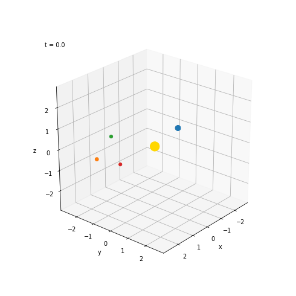

# solarsys-GNN
# N-body simulator

A small 3D gravity simulator: one star and a few planets on tilted orbits. I'm building it as the first step of a project where a GNN learns to predict how the system moves, and I test whether its explanations match the real forces. The simulator saves the true force between every pair of bodies, so the answer is known.



## Run

```
python Nbody.py --check           # energy should stay constant (drift ~1e-7)
python Nbody.py                   # generate a dataset -> nbody_train.npz
python visualize.py               # make the picture and the gif
```

Needs Python 3, NumPy, and matplotlib + pillow for the gif.

## How it works

- Newtonian gravity with a small softening term, leapfrog integrator.
- Planets start on near-circular orbits, tilted randomly out of the x-y plane.
- Saved data: positions, velocities, masses, and `force_mag[t, i, j]`, the force of body j on body i (the ground truth).

Next: the GNN.